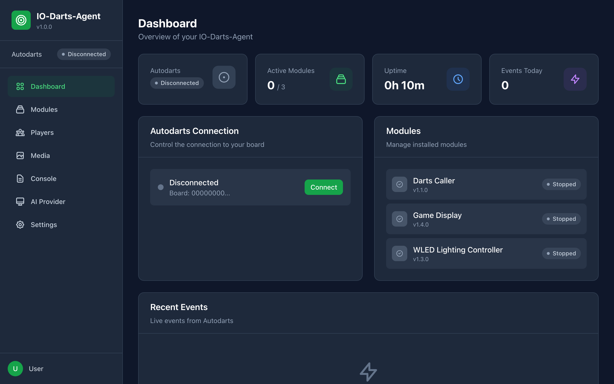
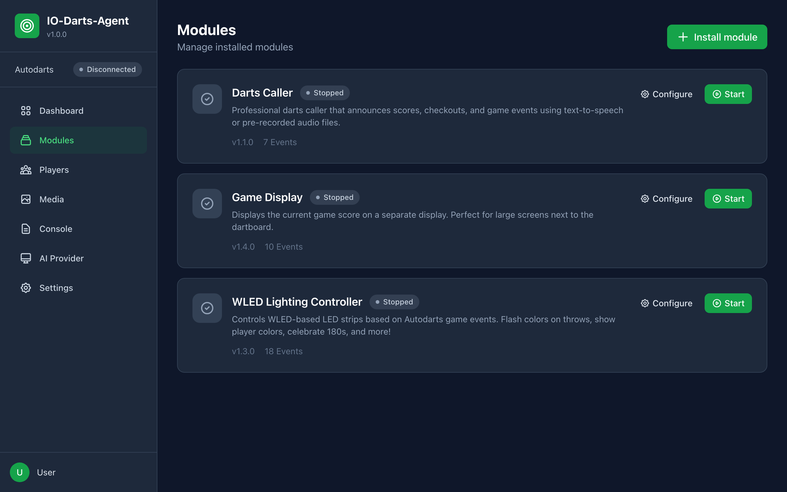
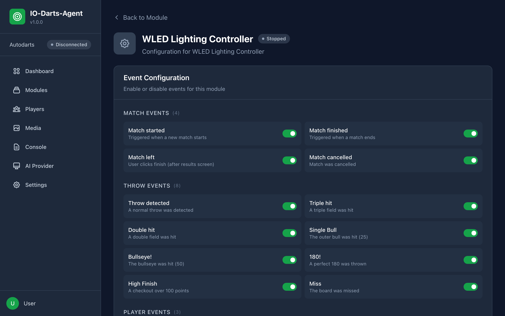
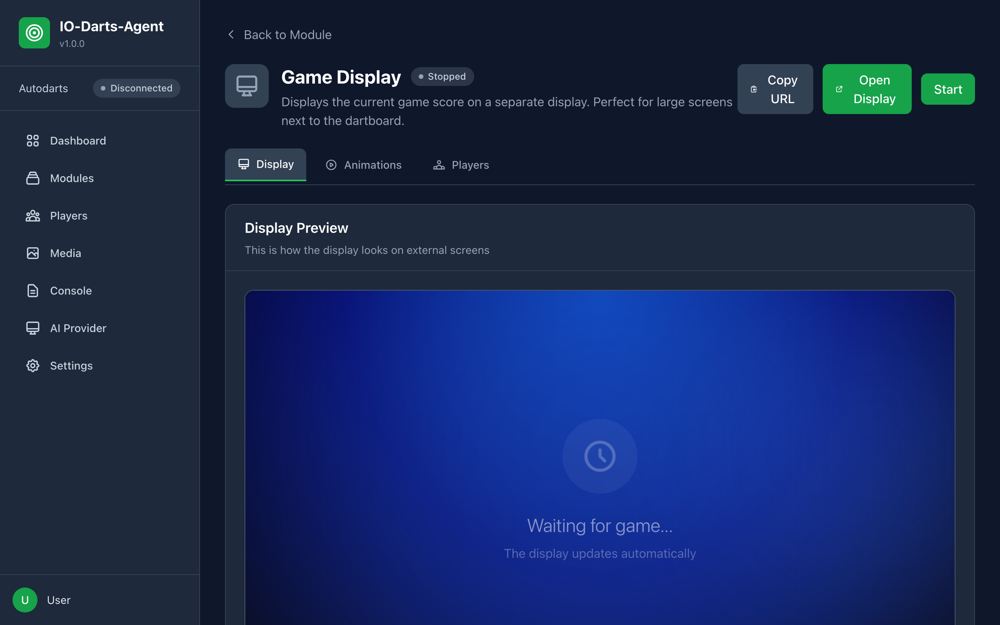
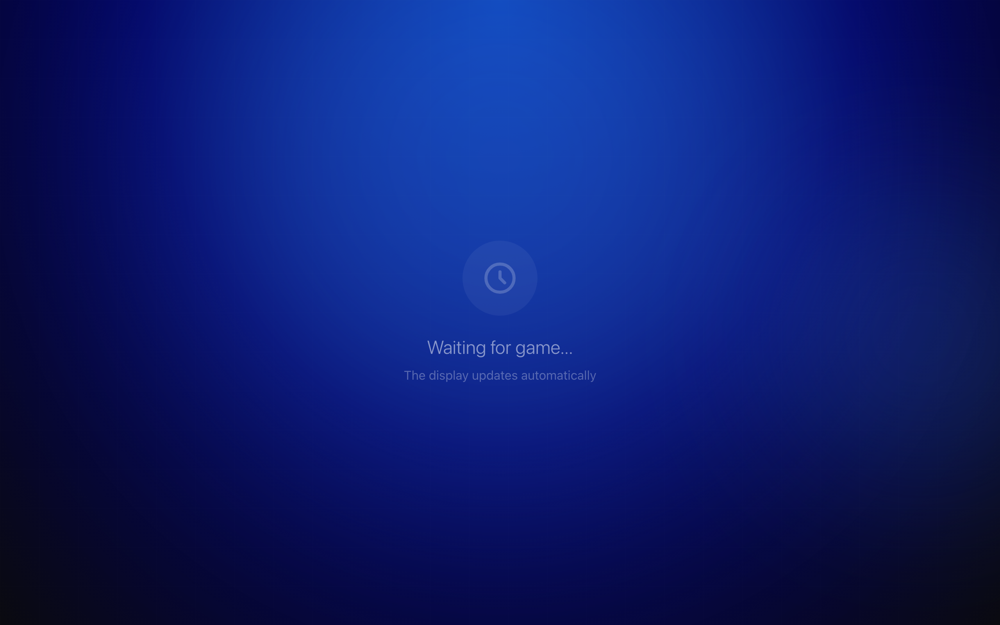
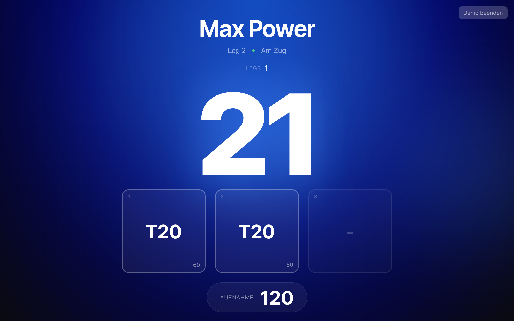
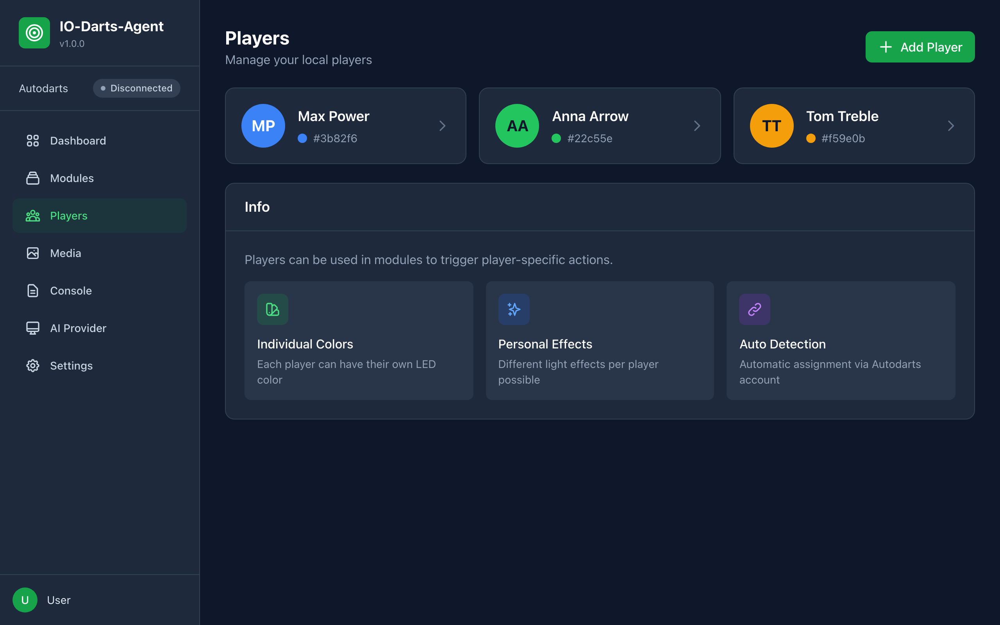
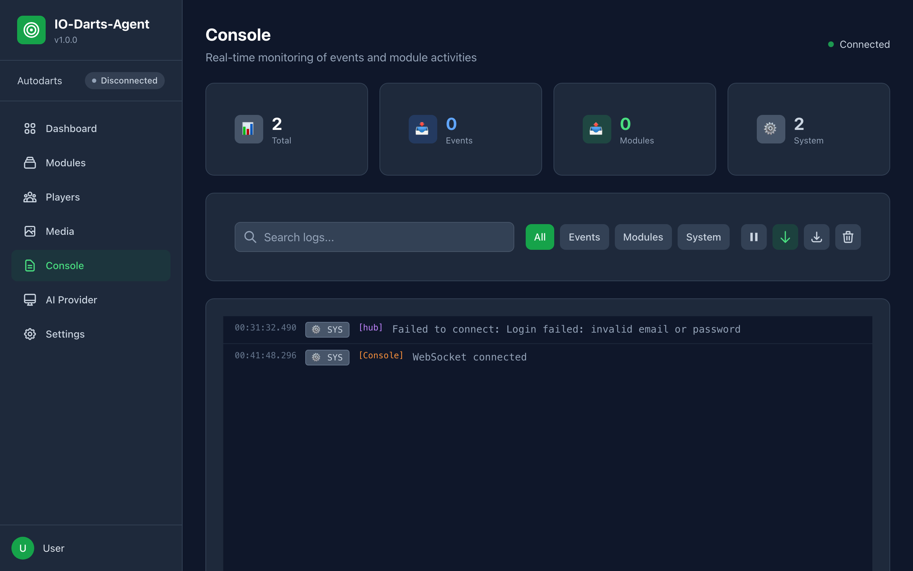
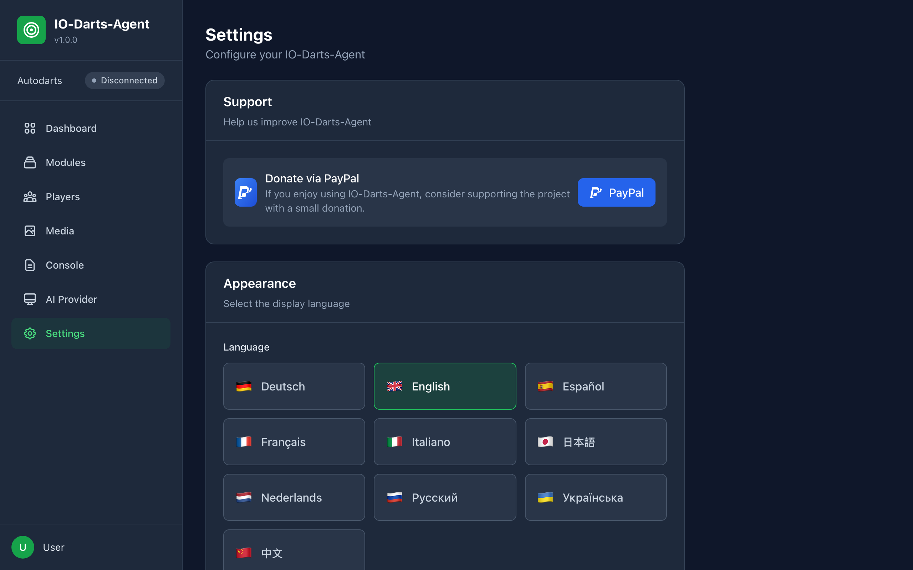
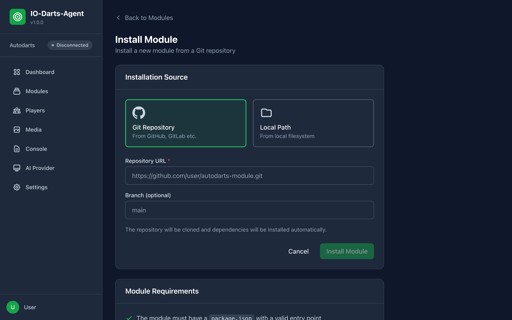

# IO-Darts-Agent: Benutzerhandbuch

Dieses Handbuch führt dich durch Einrichtung und Nutzung des IO-Darts-Agent, vom ersten Start bis zum fertigen System mit allen Modulen.

> **Hinweis**: IO-Darts-Agent ist ein inoffizielles Projekt. Es steht in keiner Verbindung zu Autodarts und wird von Autodarts weder unterstützt noch empfohlen. Der Hub ist ausschließlich für den Betrieb im lokalen Netzwerk gedacht. Stelle ihn nicht ins Internet und richte keine Portweiterleitung auf ihn ein.

---

## Inhaltsverzeichnis

1. [Was ist IO-Darts-Agent?](#was-ist-io-darts-agent)
2. [Systemvoraussetzungen](#systemvoraussetzungen)
3. [Installation](#installation)
4. [Erste Einrichtung](#erste-einrichtung)
5. [Anmeldung am Web-Interface](#anmeldung-am-web-interface)
6. [Das Dashboard](#das-dashboard)
7. [Module verwalten](#module-verwalten)
8. [WLED Modul](#wled-modul)
9. [Game Display Modul](#game-display-modul)
10. [Darts Caller Modul](#darts-caller-modul)
11. [AI Provider](#ai-provider)
12. [Animations-Generator](#animations-generator)
13. [Mediathek](#mediathek)
14. [Spielerverwaltung](#spielerverwaltung)
15. [Konsole](#konsole)
16. [Einstellungen](#einstellungen)
17. [Entwickler-Tools](#entwickler-tools)
18. [Neue Module installieren](#neue-module-installieren)
19. [Häufige Fragen (FAQ)](#faq)
20. [Problemlösung](#problemlösung)

---

## Was ist IO-Darts-Agent?

IO-Darts-Agent ist ein lokaler Hub für dein Autodarts-Board. Er empfängt die Live-Ereignisse deines Boards (Würfe, Aufnahmen, Legs, Matches) und löst damit Aktionen aus:

- **LED-Beleuchtung steuern**: Deine WLED-Beleuchtung reagiert auf Triple, 180, Bust oder Spielerwechsel
- **Punktestand anzeigen**: Der Spielstand erscheint als Vollbild auf einem zweiten Bildschirm oder Tablet
- **Sprachansagen**: Ein Darts Caller sagt Scores, Checkouts, Bust und Game Shot an
- **KI-Funktionen (optional)**: Voice Packs mit ElevenLabs, Animationen mit Runway oder Higgsfield
- **Erweiterbar**: Weitere Module lassen sich aus Git-Repositories installieren

IO-Darts-Agent steht unter der PolyForm Noncommercial License 1.0.0 und ist für private, nicht kommerzielle Nutzung kostenlos.

---

## Systemvoraussetzungen

| Komponente | Anforderung |
|------------|-------------|
| **Computer** | Windows, macOS oder Linux |
| **Node.js** | Version 22 oder neuer (nur beim Betrieb aus dem Quellcode) |
| **Browser** | Aktueller Chrome, Firefox, Safari oder Edge |
| **Netzwerk** | Der Hub und alle Anzeigegeräte und WLED-Controller im selben lokalen Netzwerk |
| **Autodarts** | Autodarts-Konto mit E-Mail und Passwort sowie ein Board |
| **ffmpeg** | Optional, für transparente KI-Animationen |

### Für das WLED-Modul zusätzlich

- WLED-kompatibler LED-Controller (z.B. ESP8266 oder ESP32 mit WLED-Firmware)
- LED-Strip (z.B. WS2812B, SK6812)

### Für KI-Funktionen zusätzlich

- API-Schlüssel des jeweiligen Anbieters (z.B. ElevenLabs, Runway, Higgsfield). Generierungen kosten beim Anbieter Guthaben bzw. Credits.

---

## Installation

Die Installation aus dem Quellcode, inklusive eines eigenen Linux-Board-PCs, ist in der [Installationsanleitung](installation.md) beschrieben.

Kurzfassung für den Betrieb aus dem Quellcode:

```bash
git clone https://github.com/Castorio/io-darts-agent.git
cd io-darts-agent
npm run setup       # installiert alle Abhängigkeiten
npm run build:app   # baut Hub, Web-Interface und Module
npm start
```

Danach ist das Web-Interface unter `http://localhost:3000` erreichbar.

---

## Erste Einrichtung

Ohne Konfiguration startet der Hub im Setup-Modus. Öffne im Browser:

```
http://localhost:3000
```

Von einem anderen Gerät im Netzwerk erreichst du den Hub über die IP des Hub-Rechners, z.B. `http://192.168.1.100:3000`.

Der Setup-Wizard hat drei Schritte.

### Schritt 1: Sicherheit

Unter **Web-Interface absichern?** legst du fest, ob das Web-Interface ein Login verlangt:

- **Aus**: Kein Login erforderlich (nur im lokalen Netzwerk empfohlen)
- **An**: Benutzername (mindestens 3 Zeichen) und Passwort (mindestens 6 Zeichen) festlegen und bestätigen

### Schritt 2: Autodarts Verbindung

Gib deine Autodarts-Zugangsdaten ein:

1. **E-Mail**: Die E-Mail-Adresse deines Autodarts-Kontos
2. **Passwort**: Dein Autodarts-Passwort
3. **Board-ID**: Die ID deines Boards (Format `xxxxxxxx-xxxx-xxxx-xxxx-xxxxxxxxxxxx`)
4. Klicke auf **Verbindung testen**

So funktioniert die Anmeldung:

- Der Hub meldet sich mit E-Mail und Passwort an der offiziellen Autodarts-API an (Auth-Dienst v1).
- Das Zugriffstoken wird automatisch vor Ablauf erneuert. Schlägt die Erneuerung fehl, meldet sich der Hub mit dem gespeicherten Passwort neu an.
- **Zwei-Faktor-Authentifizierung (2FA) wird nicht unterstützt.** Ein Konto mit aktivierter 2FA kann sich nicht verbinden.
- Die Zugangsdaten werden nur auf dem Hub-Rechner gespeichert (`dist/config/hub.config.json`, im Klartext) und nur an Autodarts gesendet.

### Schritt 3: Abschluss

Die Zusammenfassung zeigt Web-Authentifizierung, Autodarts E-Mail und Board-ID. Klicke auf **Setup abschließen**. Der Hub verbindet sich mit Autodarts. Mit aktiver Web-Authentifizierung wirst du zur Anmeldeseite weitergeleitet, sonst direkt zum Dashboard.

E-Mail, Passwort und Board-ID kannst du später unter **Einstellungen > Autodarts** ändern.

---

## Anmeldung am Web-Interface

Ist die Web-Authentifizierung aktiv, fragt die Anmeldeseite nach **Benutzername** und **Passwort** des Web-Interfaces (nicht nach den Autodarts-Daten). Abmelden kannst du dich über den Button unten in der Seitenleiste.

---

## Das Dashboard



| Bereich | Beschreibung |
|---------|-------------|
| **Aktive Module** | Anzahl der laufenden Module |
| **Laufzeit** | Laufzeit des Hubs |
| **Events heute** | Anzahl der empfangenen Ereignisse |
| **Autodarts Verbindung** | Verbindungsstatus mit Button zum Trennen bzw. Verbinden, dazu das aktive Match |
| **Module** | Installierte Module mit Status, Link zur Modulinstallation |
| **Letzte Events** | Live-Events von Autodarts |

### Navigation

Die Seitenleiste zeigt oben den Autodarts-Verbindungsstatus und führt zu allen Bereichen:

- **Dashboard**: Übersicht
- **Module**: Module verwalten und konfigurieren
- **Spieler**: Spielerprofile mit Farben
- **Mediathek**: Bilder, Sounds und Animationen
- **Konsole**: Live-Logs
- **AI Provider**: API-Schlüssel und Modelle der KI-Anbieter
- **Einstellungen**: Sprache, Server, Web-Login, Autodarts-Zugang, Entwickler-Modus

---

## Module verwalten

Module erweitern den Hub um Funktionen. Eingebaut sind **WLED**, **Game Display** und **Darts Caller**.



### Module-Übersicht

Unter **Module** siehst du alle installierten Module mit Status und den Buttons **Konfigurieren**, **Starten** bzw. **Stoppen**. Eingebaute Module, die noch nicht installiert sind, erscheinen unter **Verfügbare Module** und lassen sich mit **Installieren** hinzufügen.

### Modul-Detailseite

Ein Klick auf ein Modul öffnet die Detailseite:

- **Starten**, **Stoppen**, **Neustarten**
- **Autostart**: Modul startet automatisch mit dem Hub
- Link zur modulspezifischen Konfiguration (WLED, Game Display, Darts Caller)
- **Konfiguration**: Allgemeine Moduleinstellungen (bei Modulen ohne eigene Konfigurationsseite; beim Darts Caller dieselben Werte wie auf der Caller-Seite)
- **Intent-Reaktionen**: Wie das Modul auf Intents anderer Module reagiert (falls unterstützt)
- **Statistiken**: Neustarts, Startzeit, verarbeitete Events, letzter Fehler
- **Gefahrenzone**: **Modul deinstallieren** (löscht das Modul und seine Daten)

---

## WLED Modul

Das WLED-Modul steuert LED-Strips mit WLED-Firmware abhängig von Spielereignissen.

### WLED-Konfiguration öffnen

1. Gehe zu **Module** und öffne **WLED Lichtsteuerung**
2. Klicke auf **Event-Aktionen konfigurieren**



### Verbindung

1. **WLED IP-Adresse**: IP des Controllers, z.B. `192.168.1.100`
2. **Port**: Normalerweise `80`
3. **Übergangszeit (ms)**: Globale Übergangszeit in Millisekunden, gilt für jede Aktion, deren Übergangszeit auf "Global" steht. Leer (Standard) behält die eigene Standard-Übergangszeit des Controllers, `0` bedeutet sofortiger Wechsel.
4. Klicke auf **Verbinden**. Bei Erfolg lädt der Hub die Presets und Effekte direkt vom Controller. Ohne Verbindung steht eine eingebaute Effektliste zur Verfügung.

Oben rechts kannst du das Modul starten oder stoppen.

### Event-Aktionen

Die Ereignisse sind in Gruppen sortiert:

| Gruppe | Ereignisse |
|--------|-----------|
| **Match Events** | Match gestartet, Match beendet, Match verlassen, Match abgebrochen |
| **Wurf Events** | Wurf erkannt, Triple getroffen, Double getroffen, Single Bull, Bullseye!, 180!, Fehlwurf |
| **Spieler Events** | Spielerwechsel, Aufnahme gestartet, Aufnahme beendet |
| **Board Events** | Pfeile ziehen, Pfeile gezogen |

Ein Event "High Finish" gibt es nicht: Der Hub liefert keinen Checkout-Wert, deshalb kann das Modul ihn nicht erkennen.

Für jedes Ereignis wählst du einen Aktionstyp:

| Aktionstyp | Beschreibung |
|------------|-------------|
| **Preset** | Ein auf dem Controller gespeichertes WLED-Preset aktivieren |
| **Effekt** | Einen WLED-Effekt abspielen, mit bis zu drei Farben, Geschwindigkeit und Intensität |
| **Farbe** | Eine feste Farbe setzen |
| **Aus** | LEDs ausschalten |
| **Keine** | Keine Aktion |

Zusätzlich je Aktion:

- **Spielerfarbe verwenden** bzw. **Spielerfarbe für Farbe 1**: Statt einer festen Farbe wird die Farbe des aktuellen Spielers genutzt
- **Helligkeit**
- **Dauer**: Aus, 0.5s, 1s, 2s, 3s oder 5s. Nach Ablauf setzt das Modul wieder die Farbe des aktiven Spielers, mit der Aktion, die für **Spielerwechsel** eingestellt ist. Der vorherige WLED-Zustand wird nicht wiederhergestellt. Ohne Aktion für Spielerwechsel oder außerhalb eines Matches bleibt das Licht so, wie es ist. Bei "Aus" bleibt der Effekt bis zum nächsten Ereignis aktiv. Beim Match-Start ist die Dauer die Wartezeit, bis die Spielerfarbe gesetzt wird; nach Match-Ende, Match verlassen und Match-Abbruch wird nichts gesetzt.
- **Übergangszeit (Fade)**: Global, Sofort, 0.2s, 0.5s, 1s, 2s oder 5s. "Global" nutzt die Übergangszeit aus den Verbindungseinstellungen. Der Wert wird in Millisekunden gespeichert und nur für diesen Befehl an WLED geschickt, die Standard-Übergangszeit des Controllers bleibt unverändert.
- **Testen**: Die Aktion sofort auf dem Controller ausprobieren

Speichere mit **Konfiguration speichern**.

#### Beispiel-Konfigurationen

| Ereignis | Mögliche Aktion |
|----------|-----------------|
| **Match gestartet** | Effekt "Rainbow", Dauer 2s |
| **Spielerwechsel** | Farbe mit Spielerfarbe |
| **Triple getroffen** | Effekt "Blink", Dauer 0.5s |
| **Bullseye!** | Goldene Farbe, Dauer 1s |
| **180!** | Effekt "Fireworks", Dauer 3s |
| **Pfeile gezogen** | Farbe mit Spielerfarbe |

### Spielerfarben

Die Farbe eines Spielers wird so bestimmt:

1. Farbe aus dem passenden Spielerprofil unter **Spieler** (der Profilname muss dem Autodarts-Namen entsprechen, Groß- und Kleinschreibung egal)
2. Sonst die Farbe der Spielerposition aus dem Bereich **Spielerfarben** der WLED-Konfiguration (bis zu 6 Spieler)

Unter **Spielerfarben testen** kannst du jede Positionsfarbe direkt auf den LEDs anzeigen.

### Einzelspieler-Spiele

- Nach dem Match-Start (und einer eventuellen Start-Animation) wird die Spielerfarbe gesetzt
- Nach jedem "Pfeile gezogen" wird die Spielerfarbe wiederhergestellt
- Dafür wird die Aktion von **Spielerwechsel** verwendet, sie sollte also eine Farbe mit Spielerfarbe sein

### Schnellaktionen

Unten auf der Seite: **Rainbow Test**, **LEDs aus**, **Grün** und **Rot** zum schnellen Prüfen der Verbindung.

---

## Game Display Modul

Zeigt den Spielstand im Vollbild auf einem zweiten Bildschirm, Tablet oder Smart-TV.

### Konfiguration öffnen

1. Gehe zu **Module** und öffne **Game Display**
2. Klicke auf **Display konfigurieren**



Die Konfiguration hat drei Tabs: **Display**, **Animationen** und **Spieler**.

### Display auf einem anderen Gerät öffnen

Im Tab **Display** findest du eine Vorschau sowie die Buttons **Display öffnen** und **URL kopieren**. Die Display-URL lautet:

```
http://192.168.1.100:3000/module-ui/game-display/
```

Ersetze `192.168.1.100` durch die IP deines Hub-Rechners. Das Gerät muss im selben Netzwerk sein. Aktiviere im Browser den Vollbildmodus (F11). Auch `http://192.168.1.100:3000/display` leitet auf das Display weiter.



### Display-Elemente

| Element | Beschreibung |
|---------|-------------|
| **Spielername** | Groß oben, Hintergrund in der Spielerfarbe |
| **Punktestand** | Restpunkte, sehr groß |
| **Checkout** | Vorschlag, sobald ein Finish möglich ist |
| **Dart-Boxen** | Die drei Würfe der aktuellen Aufnahme |
| **Aufnahme** | Summe der aktuellen Aufnahme |
| **Andere Spieler** | Leiste unten mit allen Mitspielern |
| **Spielinfo** | Optional: Spielmodus, Legs, Double-In/Out |



### Display-Einstellungen

| Einstellung | Beschreibung |
|-------------|-------------|
| **Anzeigename** | Name des Displays |
| **Idle-Modus** | Anzeige ohne aktives Spiel: Letzten Spielstand anzeigen (Standard), Schwarzer Bildschirm oder Eigenes Bild |
| **Idle-Bild URL** | Bild für den Idle-Modus "Eigenes Bild" |
| **Match-Start-Modus** | Standard (Game On! Anzeige) oder Eigenes Bild/GIF |
| **Match-Start Bild URL**, **Match-Start Anzeigedauer**, **Game On Hintergrundfarbe** | Darstellung des Match-Start-Bildschirms |
| **Anzeigedauer Ergebnistabelle** | Wie lange die Ergebnisse nach Match-Ende stehen bleiben (0 = bis manuell geschlossen) |
| **Hintergrundfarbe Ergebnistabelle** | Farbe des Ergebnisbildschirms |
| **Checkout-Vorschläge anzeigen**, **Checkout ab Punktzahl** | Checkout-Wege ein- oder ausblenden, Standard ab 170 |
| **Andere Spieler anzeigen** | Leiste mit Mitspielern |
| **Spielinfo anzeigen**, **Position**, **Größe**, **Versatz** | Spielinfo-Overlay in einer Ecke |

Nach Match-Ende zeigt das Display eine Ergebnistabelle mit Chalkboard, Statistiken (z.B. Durchschnitt, geworfene Darts) und finalen Punkteständen.

### Animationen

Im Tab **Animationen** schaltest du **Animationen aktivieren** ein und legst eine **Standard-Animationsdauer** fest. Für jedes Ereignis gibt es eine eigene Animation:

| Animation | Auslöser |
|-----------|----------|
| **180 Animation** | 180 geworfen |
| **Bull Animation** | Single Bull (25) |
| **Double Bull Animation** | Bullseye (50) |
| **High Score Animation** | Aufnahme ab einer Punktzahl (Einstellung **Ab Punktzahl**), einmal pro Aufnahme nach dem dritten Dart |
| **Checkout Animation** | Erfolgreicher Checkout |
| **Leg-Sieg Animation** | Leg gewonnen |
| **Match-Sieg Animation** | Match gewonnen |
| **Überworfen Animation** | Bust |

Pro Animation:

- **Typ**: Deaktiviert, Built-in, GIF oder Video
- **Medien-URL**: GIF oder Video (Upload, Auswahl aus der Mediathek oder externe URL)
- **Sound-URL**: Optionaler Ton
- **Dauer**
- Bei Leg- und Match-Sieg zusätzlich: Gewinnernamen anzeigen, Statistiken anzeigen, Effekt (Keiner, Konfetti, Feuerwerk, Funken), Hintergrund- und Textfarbe

Unter den Animationen findest du den [Animations-Generator](#animations-generator), mit dem du Animationen per KI erzeugen kannst.

### Spieler-spezifische Animationen

Im Tab **Spieler** legst du für einzelne Spieler eigene Animationen fest. Die Liste zeigt alle Spieler aus der [Spielerverwaltung](#spielerverwaltung).

1. Klicke bei einem Spieler auf **Konfigurieren**
2. Wähle die Animation: **180 Animation**, **Leg Gewonnen**, **Match Gewonnen** oder **Checkout**
3. Wähle den **Animationstyp** (Standard, GIF, Video, Keine) und gib **GIF/Video URL** und **Sound URL** an
4. Speichern

So funktioniert es:

- Eine Spieler-Animation ersetzt die globale Animation, wenn dieser Spieler das Ereignis auslöst
- Ist für den Spieler nichts hinterlegt, wird die globale Animation verwendet
- Spieler mit eigenen Animationen sind mit **Individuelle Animationen aktiv** markiert

---

## Darts Caller Modul

Der Darts Caller sagt Scores, Checkouts und Spielereignisse an.

### Was er ansagt

- Scores nach jeder Aufnahme
- Checkout-Anforderungen ("You require ...")
- Spezial-Ansagen: 180, Bust, No Score, Game Shot, Match Shot, Game On
- Spielernamen beim Spielerwechsel

### Konfiguration

Alle Einstellungen nimmst du auf der **Caller-Seite** vor (unter **Module > Darts Caller**, Button **Caller konfigurieren**). Klicke auf **Speichern**. Die Änderungen gelten sofort, auch bei laufendem Modul, ein Neustart ist nicht nötig.

| Einstellung | Beschreibung |
|-------------|-------------|
| **Caller-Typ** | Audioquelle der Ansagen (siehe unten) |
| **Sprache** | Deutsch oder Englisch. Gilt für die Browser-Stimme und für neue Voice Packs. Browser TTS und ElevenLabs Live KI sprechen englische Ansagetexte. |
| **Stimme, Tonhöhe, Geschwindigkeit** | Nur bei Browser TTS: Systemstimme des Browsers, Tonhöhe und Tempo (50 bis 200 %) |
| **ElevenLabs-Stimme** | Bei ElevenLabs Live KI die Stimme der Live-Ansagen, bei KI Voice Pack die Stimme für neue Voice Packs |
| **Stabilität, Ähnlichkeit** | Nur bei ElevenLabs Live KI |
| **Audio-Ordner** | Nur bei Eigene Audiodateien: Ordner mit den MP3-Dateien (Standard `caller/default`) |
| **Lautstärke** | 0 bis 100 % |
| **Verzögerung** | Wartezeit vor der Ansage, 0 bis 2000 ms |
| **Caller-Verhalten** | Was angesagt wird: Punkte, nur hohe Punktzahlen (ab 100), 180, Bust, Bull, Bullseye, Spielernamen, Restpunkte ("You require ...") mit Obergrenze, Game on, Game shot |

**Stimme testen** spricht bei Browser TTS sofort mit den aktuellen, noch nicht gespeicherten Einstellungen. Bei den anderen Caller-Typen löst der Test eine 180 über das laufende Modul aus und nutzt die gespeicherten Einstellungen. Speichere also vorher.

Die Modul-Detailseite zeigt im Bereich **Konfiguration** dieselben Einstellungen als allgemeines Formular. Beide Stellen speichern in dieselbe Konfiguration. Dort findest du zusätzlich **Caller aktivieren**.

**Ältere Konfigurationen**: Hast du den Caller mit einer älteren Version eingerichtet, übernimmt der Hub die Werte beim Start automatisch in das aktuelle Format (zum Beispiel Stimm-Typ, Systemstimme, ElevenLabs-Stimme, ausgewähltes Voice Pack, Ansage-Schalter und Checkout-Grenze). Die Datei `dist/config/modules/darts-caller.json` wird beim nächsten Speichern im neuen Format geschrieben. Einstellungen, die der Caller nicht umsetzen kann, entfallen: eigene TTS-Server-URL, Event-Sounds, Text-Vorlagen und spielerspezifische Einstellungen.

### Caller-Typen

| Caller-Typ | Wiedergabe |
|------------|-----------|
| **Browser TTS** | Text-to-Speech des Browsers. Die Ansage erklingt in einem geöffneten Tab des Hub-Web-Interfaces. |
| **KI Voice Pack** | Vorab erzeugte MP3-Dateien eines Voice Packs. Wiedergabe über die Lautsprecher des Hub-Rechners. |
| **ElevenLabs Live KI** | Jede Ansage wird live bei ElevenLabs erzeugt. Wiedergabe über die Lautsprecher des Hub-Rechners. |
| **Eigene Audiodateien** | Eigene MP3-Dateien aus einem Ordner (zum Beispiel `score_60.mp3`, `180.mp3`, `game_on.mp3`, `bust.mp3`). Wiedergabe über die Lautsprecher des Hub-Rechners. |

Für die Wiedergabe auf dem Hub-Rechner nutzt der Hub `afplay` (macOS), PowerShell (Windows) oder `mpg123`, `aplay`, `paplay` bzw. `ffplay` (Linux).

### ElevenLabs einrichten

Der Darts Caller verwendet den ElevenLabs-Schlüssel aus den [AI Provider](#ai-provider)-Einstellungen. Ein eigenes Schlüsselfeld im Caller gibt es nicht.

1. Trage unter **AI Provider > ElevenLabs** deinen API-Schlüssel ein und aktiviere den Anbieter
2. Starte das Modul Darts Caller neu, damit es den Schlüssel übernimmt
3. Wähle auf der Caller-Seite den **Caller-Typ** **ElevenLabs Live KI** oder **KI Voice Pack**. Die Liste deiner ElevenLabs-Stimmen wird geladen.

Ist kein Schlüssel hinterlegt, zeigt die Caller-Seite **ElevenLabs nicht konfiguriert** mit einem Link zu den Einstellungen.

### Voice Packs

Ein Voice Pack enthält alle Ansagen als vorab erzeugte Audio-Dateien. Dadurch gibt es keine Verzögerung und keine laufenden Kosten pro Ansage.

Der Bereich **Voice Packs** erscheint auf der Caller-Seite beim Caller-Typ **KI Voice Pack**:

- **Neues Voice Pack erstellen** (nur mit ElevenLabs): Erzeugt mit der gewählten ElevenLabs-Stimme und Sprache alle Dateien: Scores 0 bis 180, alle möglichen Checkouts 2 bis 170 und Spezial-Ansagen. Der Fortschritt wird angezeigt, die Generierung lässt sich abbrechen.
- **Voice Pack hochladen**: Ein bestehendes Voice Pack als ZIP-Datei importieren (auch ohne ElevenLabs)
- **Verfügbare Voice Packs**: Pack auswählen (wird sofort gespeichert und genutzt) oder löschen

**Spielernamen**: Ist ein Voice Pack aktiv und ElevenLabs eingerichtet, erkennt der Caller beim Match-Start neue Spieler und erzeugt deren Namen automatisch mit der Stimme des Packs.

### TTS-Cache

Im Modus **ElevenLabs Live KI** speichert der Hub erzeugte Ansagen in einem Cache (`dist/data/tts-cache`). Wiederholte Sätze werden aus dem Cache abgespielt und nicht erneut bei ElevenLabs angefragt.

---

## AI Provider

Unter **AI Provider** in der Seitenleiste verwaltest du die KI-Anbieter. Alle sind optional.

| Anbieter | Verwendung im Hub |
|----------|-------------------|
| **OpenAI** | Textmodelle für Module |
| **Anthropic** | Textmodelle für Module |
| **Ollama (Lokal)** | Lokale Textmodelle, ohne API-Schlüssel, Standard-URL `http://localhost:11434` |
| **ElevenLabs** | Sprachsynthese für den Darts Caller |
| **Stability AI** | Bildmodelle für Module |
| **Runway ML** | Videos für den Animations-Generator |
| **Higgsfield** | Videos für den Animations-Generator, dazu Bildmodelle |
| **Replicate** | Verschiedene Modelle für Module |

Die eingebauten Module nutzen ElevenLabs (Darts Caller) sowie Runway und Higgsfield (Animations-Generator). Die übrigen Anbieter stehen Modulen über die Hub-Schnittstelle zur Verfügung.

### Anbieter einrichten

1. Klicke auf einen Anbieter, um ihn aufzuklappen
2. Trage den **API-Schlüssel** ein (bei Ollama stattdessen die **Base URL**). Ein bereits gespeicherter Schlüssel wird nicht angezeigt, ein leeres Feld behält ihn.
3. Wähle das **Standard-Modell**
4. Klicke auf **Speichern** und anschließend auf **Verbindung testen**
5. Schalte den Anbieter mit dem Schalter rechts ein oder aus (erst möglich, wenn er konfiguriert ist)

Die Schlüssel werden auf dem Hub-Rechner in `dist/config/ai-providers.json` gespeichert, im Klartext. Sie verlassen den Hub nur in Richtung des jeweiligen Anbieters.

### Modelllisten

- **OpenAI** und **Anthropic**: Sobald ein Schlüssel gespeichert ist, lädt der Hub die Modelle live beim Anbieter, die dieser Schlüssel nutzen darf. Bis dahin gilt eine eingebaute Liste. Ist ein gespeichertes Modell nicht mehr verfügbar, erscheint ein Hinweis und das erste angebotene Modell wird vorausgewählt.
- **Higgsfield**: Fester Katalog mit 20 Text-zu-Video- und 10 Text-zu-Bild-Modellen. Es gibt zwei Auswahlfelder: **Standard-Modell** für Video (Standard: Kling 3.0 Standard) und **Bildmodell** (Standard: Soul Standard, im Katalog "SOUL").
- **Runway**: Fester Katalog mit 23 Text-zu-Video-Modellen aus der Runway-API (Standard: Gen-4.5), auch ohne gespeicherten Schlüssel sichtbar. Ist ein gespeichertes Modell nicht mehr verfügbar (z.B. Gen-3 Alpha Turbo), erscheint ein Hinweis und Gen-4.5 wird vorausgewählt. Bis zum Speichern nutzt der Hub ebenfalls Gen-4.5.
- Die übrigen Anbieter nutzen eine eingebaute Liste.

### Runway

- Das **Standard-Modell** bestimmt, mit welchem Modell der Animations-Generator arbeitet. Gen-4.5 ist das eigene Modell von Runway und kostet 12 Credits pro Sekunde. Die Preise der anderen Modelle stehen unter [docs.dev.runwayml.com/guides/pricing](https://docs.dev.runwayml.com/guides/pricing).
- Animationen entstehen per Text-zu-Video, ohne Platzhalterbild. Der Hub passt jede Anfrage an das gewählte Modell an: erlaubtes Seitenverhältnis passend zur Ausrichtung (bevorzugt 720p), erlaubte Dauer (nächstliegender Wert), Ton aus und Prompt auf die Höchstlänge des Modells gekürzt.
- Eine Generierung wird genau einmal gesendet. Antwortet Runway mit einem Serverfehler oder gar nicht, kann der Auftrag trotzdem gestartet und berechnet worden sein. Der Hub wiederholt ihn deshalb nicht automatisch, der Job wird als fehlgeschlagen gemeldet. Prüfe vor einem neuen Versuch das Runway-Dashboard. Statusabfragen werden weiterhin wiederholt.

### Higgsfield

- Den Schlüssel trägst du im Format `KEY_ID:KEY_SECRET` ein (Key-ID und Secret aus der Higgsfield Console, getrennt durch einen Doppelpunkt).
- Der Hub passt jede Anfrage an das gewählte Modell an: erlaubte Dauer, unterstütztes Seitenverhältnis (das nächstliegende wird gewählt) und Ton aus. Die Animationen laufen stumm, nativer Ton würde nur Kosten verursachen.

> **Kosten**: Jede Generierung bei Runway, Higgsfield, ElevenLabs oder anderen Anbietern verbraucht dort Guthaben bzw. Credits.

---

## Animations-Generator

Der Animations-Generator erzeugt per KI kurze Animationen für das Game Display. Du findest ihn in der Game Display Konfiguration im Tab **Animationen** (sichtbar, wenn **Animationen aktivieren** an ist).

### Ablauf

1. **Engine** wählen: **Runway** oder **Higgsfield**. Eine Engine ohne Schlüssel ist mit "nicht eingerichtet" markiert. Den Schlüssel trägst du unter [AI Provider](#ai-provider) ein.
2. **Stil wählen**: Fire, Ice, Neon, Gold, Cartoon, Minimal, Electric, Confetti, Smoke oder Stars. Alternativ **Eigener Stil** mit Name und Beschreibung.
3. **Ereignisse wählen**: 180, Bull, Double Bull, High Score (160+), Checkout, Leg Gewinn, Match Gewinn, Bust. Mit **Alle** bzw. **Keine** wählst du alle oder keine aus.
4. **Animationen generieren**: Für jedes gewählte Ereignis entsteht ein eigener Job (Batch).

### Jobs

Unter **Generierungs-Jobs** siehst du jeden Auftrag mit Status (Wartend, In Warteschlange, Wird generiert..., Fertig, Fehlgeschlagen, Abgebrochen) und Fortschritt.

- Laufende Jobs lassen sich **abbrechen**
- Fertige Jobs haben eine **Vorschau** und den Button **Verwenden**, der die Animation für das jeweilige Ereignis im Tab Animationen einträgt
- **Abgeschlossene löschen** räumt die Liste auf

### Ergebnis

- Das Video wird mit `ffmpeg` in ein transparentes WebM umgewandelt (schwarzer Hintergrund wird ausgestanzt), damit die Animation über dem Spielstand liegt.
- Ist `ffmpeg` nicht installiert oder schlägt die Umwandlung fehl, bleibt das Original als MP4 erhalten.
- Die Dateien landen in der [Mediathek](#mediathek) unter **Animationen** im Ordner `ai-generated/<Stil>`.

Eine Video-Generierung kann je nach Anbieter einige Minuten dauern und kostet beim Anbieter Credits.

---

## Mediathek

Unter **Mediathek** verwaltest du Bilder, Sounds und Animationen für die Module.

- Tabs **Animationen** (GIF, MP4, WebM, MOV), **Sounds** (MP3, WAV, OGG, WebM-Audio) und **Bilder** (PNG, JPG, WebP, SVG)
- **Hochladen** per Button oder Drag and Drop, maximal 50 MB pro Datei
- **Neuer Ordner** zum Strukturieren (nur leere Ordner lassen sich löschen)
- **Dateien suchen**
- **URL kopieren**, um eine Datei in einem Modul zu verwenden
- Dateien löschen

In den Animations- und Sound-Feldern der Module kannst du direkt hochladen, aus der Mediathek wählen oder eine externe URL angeben.

---

## Spielerverwaltung

Unter **Spieler** legst du lokale Spielerprofile an.



### Neuen Spieler anlegen

1. Klicke auf **Spieler hinzufügen**
2. **Spielername**: Muss dem Namen in Autodarts entsprechen (Groß- und Kleinschreibung egal)
3. **Farbe**: Aus der Palette wählen oder mit **Eigene Farbe wählen** einen Hex-Farbcode eingeben
4. **Avatar**: Ein Symbol für den Spieler
5. **Autodarts Benutzer-ID (optional)**: Wird mit dem Profil gespeichert
6. Klicke auf **Erstellen**

### Wofür die Profile genutzt werden

- **WLED**: LEDs leuchten in der Spielerfarbe
- **Game Display**: Spielerfarbe im Display, spieler-spezifische Animationen

---

## Konsole

Die **Konsole** zeigt alle Ereignisse und Modul-Aktivitäten in Echtzeit.



| Typ | Bedeutung |
|-----|-----------|
| **Event** | Ereignis von Autodarts an den Hub |
| **Modul** | Aktion eines Moduls (Hub an Geräte) |
| **System** | System-Meldung |

Funktionen: Zähler pro Typ, Filter, **Logs durchsuchen**, **Pausieren**/**Fortsetzen**, **Auto-Scroll**, **Logs exportieren**, **Logs löschen** und **Max. Einträge**.

Nützlich, um zu prüfen, ob Ereignisse ankommen und ob Module Befehle senden.

---

## Einstellungen



| Bereich | Inhalt |
|---------|--------|
| **Unterstützung** | Spende über PayPal |
| **Darstellung** | **Sprache** des Interfaces: Deutsch, English, Español, Français, Italiano, 日本語, Nederlands, Русский, Українська, 中文. Deutsch und Englisch sind vollständig übersetzt, die übrigen teilweise. |
| **Server** | **Host** (Standard `0.0.0.0`) und **Port** (Standard 3000). Änderungen erfordern einen Neustart des Hubs: Nutze **Hub neu starten** neben dem Hinweis, die Seite lädt neu, sobald der Hub zurück ist. Der Host wird gespeichert, aber derzeit ignoriert: Der Hub bindet immer an `0.0.0.0`. |
| **Web-Authentifizierung** | Login für das Web-Interface ein- oder ausschalten, Benutzername und neues Passwort |
| **Autodarts** | E-Mail, neues Passwort und Board-ID. Ein leeres Passwortfeld behält das gespeicherte Passwort. |
| **Entwickler-Modus** | Schaltet die Entwickler-Tools frei |

Speichere mit **Speichern**.

---

## Entwickler-Tools

Nach dem Aktivieren des **Entwickler-Modus** in den Einstellungen öffnest du über **Entwickler-Tools öffnen** eine Seite, auf der du Autodarts-Ereignisse ohne echtes Board simulierst:

- **Match starten** mit zwei Spielern (Name, Farbe, Startwert), **Match beenden**, **Match abbrechen**
- **Wurf-Simulator**: Zahl und Multiplikator wählen und **Werfen**
- **Aufnahme beenden (Spielerwechsel)**
- **Test-Szenarien**: Vordefinierte Abläufe ausführen

So kannst du WLED, Game Display und Caller testen, ohne zu werfen.

---

## Neue Module installieren

1. Gehe zu **Module** und klicke auf **Modul installieren**



### Aus Git installieren

1. Wähle **Git Repository**
2. Gib die **Repository URL** ein, z.B. `https://github.com/user/autodarts-module.git`
3. Optional: **Branch (optional)**
4. Klicke auf **Installieren**. Das Repository wird geklont und die Abhängigkeiten werden installiert.

### Lokales Modul installieren

1. Wähle **Lokaler Pfad**
2. Gib unter **Pfad zum Modul** den absoluten Pfad zum Modul-Ordner an
3. Klicke auf **Installieren**

Installiere nur Module aus Quellen, denen du vertraust. Ein Modul läuft mit den Rechten des Hubs.

---

## FAQ

### Muss der Hub immer laufen?

Ja, nur ein laufender Hub verarbeitet Ereignisse.

### Kann ich mehrere Boards nutzen?

Ein Hub ist einem Board zugeordnet. Für mehrere Boards brauchst du mehrere Hub-Instanzen.

### Werden meine Daten irgendwo hochgeladen?

Der Hub verbindet sich mit Autodarts, mit deinen eigenen Geräten im Netzwerk (z.B. WLED) und nur dann mit KI-Anbietern, wenn du sie eingerichtet hast. Zugangsdaten und API-Schlüssel liegen im Klartext auf dem Hub-Rechner.

### Kann ich das Display auf einem Tablet öffnen?

Ja, öffne die Display-URL im Browser des Tablets. Das Tablet muss im selben Netzwerk sein.

### Mein Autodarts-Konto nutzt 2FA. Was nun?

Konten mit Zwei-Faktor-Authentifizierung werden nicht unterstützt. Die Anmeldung schlägt fehl.

### Meine LEDs reagieren nicht

1. Prüfe die IP-Adresse des WLED-Controllers
2. Öffne `http://192.168.1.100/json/state` im Browser (mit der IP deines Controllers)
3. Prüfe in der Konsole, ob Ereignisse ankommen
4. Stelle sicher, dass das WLED-Modul läuft

### Die Ansagen funktionieren nicht

1. Prüfe den **Caller-Typ** auf der Caller-Seite und ob **Caller aktivieren** eingeschaltet ist
2. Bei **Browser TTS** muss ein Tab des Hub-Web-Interfaces geöffnet sein
3. Bei Voice Pack, ElevenLabs und eigenen Audiodateien kommt der Ton aus den Lautsprechern des Hub-Rechners
4. Prüfe Lautstärke und die Konsole auf Fehler

---

## Problemlösung

### Server startet nicht

```
Error: listen EADDRINUSE: address already in use 0.0.0.0:3000
```

Port 3000 ist belegt. Beende das andere Programm oder ändere den Port in den Einstellungen bzw. in `dist/config/hub.config.json`.

### Keine Verbindung zu Autodarts

1. Prüfe E-Mail und Passwort unter **Einstellungen > Autodarts** (die Fehlermeldung "invalid email or password" weist auf falsche Zugangsdaten hin)
2. Prüfe, ob 2FA aktiv ist (nicht unterstützt)
3. Prüfe die Board-ID
4. Prüfe die Internetverbindung des Hub-Rechners

### WLED reagiert nicht

1. Prüfe die IP-Adresse
2. Ping den Controller: `ping 192.168.1.100`
3. Öffne die WLED-Oberfläche direkt im Browser
4. Prüfe die Konsole

### Display lädt nicht

1. Prüfe, ob der Hub läuft
2. Prüfe die URL (muss auf `/module-ui/game-display/` enden)
3. Lösche den Browser-Cache oder versuche einen anderen Browser

### Spielerfarben werden nicht verwendet

1. Prüfe, ob ein Spielerprofil angelegt ist
2. Der Spielername muss dem Autodarts-Namen entsprechen
3. Prüfe, ob bei der Aktion **Spielerfarbe verwenden** aktiv ist

### WLED-Farbe fehlt im Einzelspieler-Spiel

1. Die Aktion von **Spielerwechsel** muss eine Farbe mit **Spielerfarbe verwenden** sein
2. Diese Aktion wird auch im Einzelspieler-Spiel genutzt

### Voice Pack Generierung schlägt fehl

1. Prüfe den ElevenLabs-Schlüssel unter **AI Provider**
2. Prüfe dein Zeichen-Kontingent bei ElevenLabs
3. Starte das Modul Darts Caller neu, nachdem du den Schlüssel geändert hast
4. Prüfe die Server-Logs

### Animations-Generator zeigt "KI-Generierung nicht verfügbar"

1. Die gewählte Engine (Runway oder Higgsfield) braucht einen Schlüssel unter **AI Provider**
2. Bei Higgsfield das Format `KEY_ID:KEY_SECRET` beachten
3. Animationen sind nicht transparent: `ffmpeg` installieren und im `PATH` verfügbar machen

---

## Hilfe und Support

- **Konsole prüfen**: Die meisten Probleme sind dort erkennbar
- **GitHub Issues**: Fehler melden oder Fragen stellen unter [github.com/Castorio/io-darts-agent](https://github.com/Castorio/io-darts-agent)

---

*IO-Darts-Agent ist ein inoffizielles Projekt und steht in keiner Verbindung zu Autodarts.*
