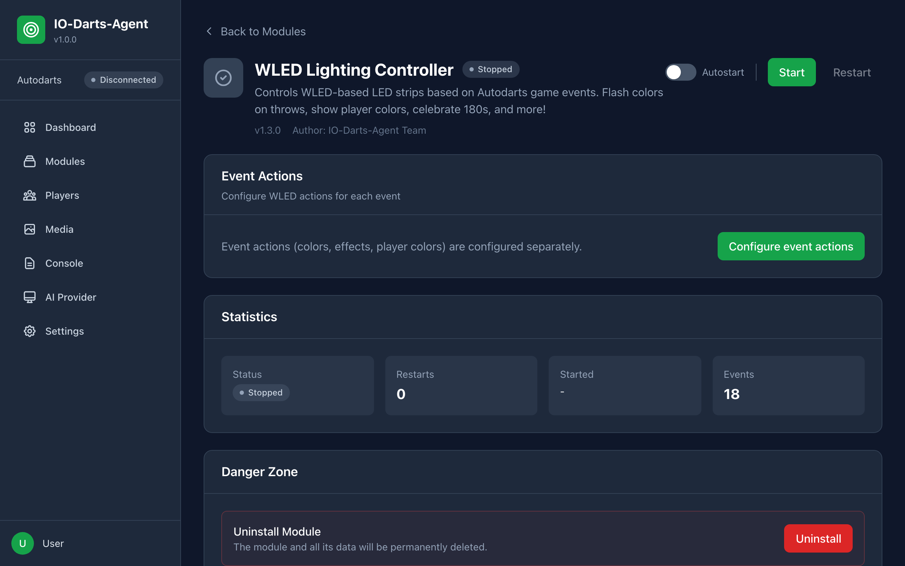
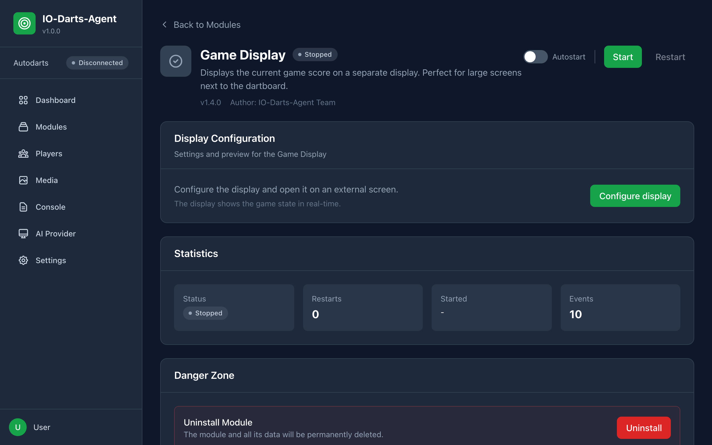

# IO-Darts-Agent - Benutzerhandbuch

Dieses Handbuch führt dich Schritt für Schritt durch die Einrichtung und Nutzung des IO-Darts-Agent. Vom ersten Start bis zum fertigen System mit allen Modulen.

---

## Inhaltsverzeichnis

1. [Was ist IO-Darts-Agent?](#was-ist-io-darts-agent)
2. [Systemvoraussetzungen](#systemvoraussetzungen)
3. [Installation](#installation)
4. [Erste Einrichtung](#erste-einrichtung)
5. [Das Dashboard](#das-dashboard)
6. [Module verwalten](#module-verwalten)
7. [WLED Modul - LED-Beleuchtung](#wled-modul)
8. [Game Display Modul - Punkteanzeige](#game-display-modul)
9. [Spielerverwaltung](#spielerverwaltung)
10. [Live-Logs](#live-logs)
11. [Einstellungen](#einstellungen)
12. [Neue Module installieren](#neue-module-installieren)
13. [Häufige Fragen (FAQ)](#faq)
14. [Problemlösung](#problemlösung)

---

## Was ist IO-Darts-Agent?

IO-Darts-Agent ist eine Software, die sich mit deinem Autodarts-System verbindet und bei verschiedenen Spielereignissen Aktionen auslösen kann:

- **🎨 LED-Beleuchtung steuern** - Bei einem Triple blinkt deine WLED-Beleuchtung
- **📺 Punktestand anzeigen** - Zeige den Spielstand auf einem zweiten Bildschirm
- **🔔 Benachrichtigungen senden** - Erhalte Meldungen bei besonderen Ereignissen
- **🎵 Sounds abspielen** - (kommt bald)
- **Und vieles mehr** - Das System ist erweiterbar!

---

## Systemvoraussetzungen

### Mindestanforderungen

| Komponente | Anforderung |
|------------|-------------|
| **Computer** | Windows 10+, macOS 10.15+, oder Linux (Ubuntu 20.04+) |
| **Browser** | Chrome, Firefox, Safari oder Edge (aktuell) |
| **Netzwerk** | Gleiches Netzwerk wie dein Autodarts-Board |
| **Autodarts** | Account mit API-Zugang (kostenlos) |

> **Hinweis**: Node.js ist **nicht** erforderlich! Die App bringt alles mit.

### Für WLED-Modul zusätzlich

- WLED-kompatibler LED-Controller (z.B. ESP8266/ESP32)
- WLED-Firmware Version 0.13+

---

## Installation

### Download

Lade die passende Version für dein System herunter:
👉 [GitHub Releases](https://github.com/nicokempe/io-darts-agent/releases)

| System | Datei |
|--------|-------|
| **Windows** | `io-darts-agent Setup X.X.X.exe` |
| **macOS** | `io-darts-agent-X.X.X.dmg` |
| **Ubuntu/Debian** | `io-darts-agent_X.X.X_amd64.deb` |
| **Linux (Universal)** | `io-darts-agent-X.X.X.AppImage` |

### Installation

**Windows:** Doppelklick auf die `.exe` → Installer folgen

**macOS:** `.dmg` öffnen → App in Applications ziehen

**Ubuntu:** `sudo dpkg -i io-darts-agent_X.X.X_amd64.deb`

**Linux:** `chmod +x *.AppImage && ./io-darts-agent-X.X.X.AppImage`

Detaillierte Anleitungen: [Installation](installation.md)

### App starten

Nach der Installation startet die App automatisch. Du findest sie:
- **Windows**: Start-Menü → "IO-Darts-Agent"
- **macOS**: Launchpad → "IO-Darts-Agent"
- **Linux**: Anwendungsmenü oder Terminal: `io-darts-agent`

Die App läuft im System Tray / der Menüleiste

---

## Erste Einrichtung

### Schritt 1: Browser öffnen

Öffne deinen Browser und gehe zu:
```
http://localhost:3000
```

Du siehst den Setup-Wizard:


*(Falls du bereits eingerichtet hast, siehst du das Dashboard)*

### Schritt 2: Autodarts-Anmeldung

Gib deine Autodarts-Zugangsdaten ein:

1. **E-Mail**: Deine Autodarts E-Mail-Adresse
2. **Passwort**: Dein Autodarts-Passwort

> 💡 **Hinweis**: Die Daten werden nur lokal auf deinem Computer gespeichert und direkt an Autodarts gesendet.

### Schritt 3: Board auswählen

Nach erfolgreicher Anmeldung siehst du deine Boards. Wähle das Board aus, das du verwenden möchtest.

### Schritt 4: Fertig!

Klicke auf "Einrichtung abschließen". Der Hub verbindet sich automatisch mit Autodarts.

---

## Das Dashboard

Nach der Einrichtung siehst du das Dashboard:


### Bereiche des Dashboards

| Bereich | Beschreibung |
|---------|-------------|
| **Verbindungsstatus** | Zeigt ob die Verbindung zu Autodarts aktiv ist |
| **Module** | Übersicht der installierten und aktiven Module |
| **Aktivität** | Letzte Events und Aktionen |
| **Schnellzugriff** | Links zu wichtigen Funktionen |

### Navigation

Die Seitenleiste links führt zu allen Bereichen:

- 🏠 **Dashboard** - Übersicht
- 📦 **Module** - Module verwalten
- 👥 **Spieler** - Spielerprofile
- 📜 **Logs** - Live-Events
- ⚙️ **Einstellungen** - Konfiguration

---

## Module verwalten

Module sind Erweiterungen, die verschiedene Funktionen hinzufügen.

### Module-Übersicht öffnen

Klicke in der Seitenleiste auf **Module**:


### Modul-Status

| Symbol | Bedeutung |
|--------|-----------|
| 🟢 **Running** | Modul ist aktiv und verarbeitet Events |
| 🔴 **Stopped** | Modul ist gestoppt |
| ⚠️ **Error** | Modul hat einen Fehler |

### Modul starten/stoppen

1. Klicke auf ein Modul in der Liste
2. Nutze die **Start** oder **Stop** Buttons

---

## WLED Modul

Das WLED-Modul steuert LED-Strips basierend auf Spielereignissen.

### Was du brauchst

- WLED-Controller (z.B. ESP8266/ESP32 mit WLED-Firmware)
- LED-Strip (WS2812B, SK6812, etc.)
- Der Controller muss im selben Netzwerk sein

### WLED-Modul öffnen

1. Gehe zu **Module**
2. Klicke auf **WLED Lighting Controller**



### WLED konfigurieren

Klicke auf **WLED konfigurieren**:


### Grundeinstellungen

1. **WLED IP-Adresse**: Gib die IP deines WLED-Controllers ein (z.B. `192.168.1.100`)
2. **Port**: Normalerweise `80`
3. Klicke auf **Speichern**

### Event-Aktionen einrichten

Für jedes Ereignis kannst du eine Aktion festlegen:

#### Beispiel: Triple-Treffer

1. Scrolle zu **Wurf Events**
2. Bei **Triple** wähle:
   - **Aktionstyp**: `Effekt`
   - **Effekt**: `Blink` oder `Rainbow`
   - **Helligkeit**: `255` (Maximum)
   - **Dauer**: `500` (0.5 Sekunden, dann zurück zum vorherigen Zustand)
3. Aktiviere **Spielerfarbe verwenden** (optional)

#### Beliebte Konfigurationen

| Event | Empfohlene Aktion |
|-------|-------------------|
| **Match Start** | Effekt "Rainbow" |
| **Spielerwechsel** | Solid-Farbe mit Spielerfarbe |
| **Triple** | Kurzer Blink (500ms) |
| **Bullseye** | Goldener Flash |
| **180** | Feuerwerk-Effekt (3s) |
| **Bust** | Roter Alarm (1s) |

### Spielerfarben

Wenn du **Spielerfarbe verwenden** aktivierst, nimmt der Effekt automatisch die Farbe des aktuellen Spielers. Dafür musst du:

1. In der **Spielerverwaltung** Spielerprofile anlegen
2. Jedem Spieler eine Farbe zuweisen
3. Der Name muss mit dem Autodarts-Namen übereinstimmen

---

## Game Display Modul

Zeigt den Spielstand auf einem separaten Bildschirm an.

### Perfekt für

- Zweiten Monitor neben dem Board
- Tablet an der Wand
- Smart-TV als Zuschauer-Display

### Game Display öffnen

1. Gehe zu **Module**
2. Klicke auf **Game Display**



### Konfiguration öffnen

Klicke auf **Display konfigurieren**:


### Display auf anderem Gerät öffnen

1. Klicke auf **URL kopieren**
2. Öffne die URL auf dem Zielgerät:
   ```
   http://DEINE-IP:3000/module-ui/game-display/
   ```
   (Ersetze `DEINE-IP` mit der IP deines Computers)
3. Aktiviere den Vollbildmodus (F11)

### Das Display

So sieht das Display während eines Spiels aus:


*Warte-Ansicht ohne aktives Spiel*


*Demo-Modus mit Beispieldaten*

### Display-Elemente

| Element | Beschreibung |
|---------|-------------|
| **Spielername** | Groß oben angezeigt |
| **Status** | Leg, Set, "Am Zug" |
| **Punktestand** | Sehr große Restpunkte |
| **Checkout** | Vorschlag wenn Finish möglich |
| **Dart-Boxen** | Zeigt alle 3 Würfe der Aufnahme |
| **Aufnahme** | Summe der aktuellen Aufnahme |
| **Andere Spieler** | Leiste unten mit allen Mitspielern |

### Demo-Modus testen

Wenn kein Spiel läuft, kannst du den Demo-Modus nutzen:

1. Klicke oben rechts auf **Demo starten**
2. Das Display zeigt Beispieldaten
3. Klicke auf **Demo beenden** zum Zurücksetzen

---

## Spielerverwaltung

Hier legst du Spielerprofile mit individuellen Farben an.

### Spieler öffnen

Klicke in der Seitenleiste auf **Spieler**:


### Neuen Spieler anlegen

1. Klicke auf **Spieler hinzufügen**
2. Fülle die Felder aus:
   - **Name**: Der Haupt-Name
   - **Aliase**: Alternative Namen (z.B. für unterschiedliche Autodarts-Profile)
   - **Farbe**: Klicke auf das Farbfeld und wähle eine Farbe
3. Klicke auf **Speichern**

### Wozu Spielerfarben?

Die Farben werden von Modulen verwendet:
- **WLED**: LEDs leuchten in der Spielerfarbe
- **Game Display**: Hintergrund in der Spielerfarbe

### Aliase verstehen

Wenn dein Autodarts-Name "MaxDarts2024" ist, du aber als "Max" angezeigt werden willst:

1. Name: `Max`
2. Aliase: `MaxDarts2024`

Der Hub erkennt "MaxDarts2024" und verwendet das Profil "Max".

---

## Live-Logs

Hier siehst du alle Events und Modul-Aktivitäten in Echtzeit.

### Logs öffnen

Klicke in der Seitenleiste auf **Logs**:


### Log-Einträge verstehen

| Typ | Farbe | Bedeutung |
|-----|-------|-----------|
| **event** | 🔵 Blau | Autodarts-Event empfangen |
| **module** | 🟣 Lila | Modul-Aktivität |
| **system** | ⚪ Grau | System-Meldung |

### Nützlich für

- **Debugging**: Prüfen ob Events ankommen
- **WLED-Test**: Sehen ob Befehle gesendet werden
- **Problembehebung**: Fehler identifizieren

---

## Einstellungen

Hier kannst du die Hub-Konfiguration ändern.

### Einstellungen öffnen

Klicke in der Seitenleiste auf **Einstellungen**:


### Verfügbare Einstellungen

| Einstellung | Beschreibung |
|-------------|-------------|
| **Server-Port** | Port auf dem der Hub läuft (Standard: 3000) |
| **Autodarts-Zugangsdaten** | E-Mail/Passwort ändern |
| **Board** | Anderes Board auswählen |

> ⚠️ **Hinweis**: Nach Änderungen muss der Server möglicherweise neu gestartet werden.

---

## Neue Module installieren

Du kannst zusätzliche Module aus Git-Repositories installieren.

### Modul-Installation öffnen

1. Gehe zu **Module**
2. Klicke auf **Modul installieren**


### Aus Git installieren

1. Wähle **Git Repository**
2. Gib die Git-URL ein, z.B.:
   ```
   https://github.com/user/autodarts-module.git
   ```
3. Optional: Gib einen Branch an (Standard: main)
4. Klicke auf **Installieren**

### Lokales Modul installieren

1. Wähle **Lokaler Pfad**
2. Gib den Pfad zum Modul-Ordner ein
3. Klicke auf **Installieren**

---

## FAQ

### ❓ Muss der Hub immer laufen?

Ja, der Hub muss laufen, damit Events verarbeitet werden. Am besten richtest du ihn als Autostart ein.

### ❓ Kann ich mehrere Boards nutzen?

Nein, ein Hub ist immer einem Board zugeordnet. Für mehrere Boards brauchst du mehrere Hub-Instanzen.

### ❓ Werden meine Daten irgendwo hochgeladen?

Nein! Alle Daten bleiben lokal auf deinem Computer. Es werden nur Verbindungen zu Autodarts und deinen eigenen Geräten (z.B. WLED) hergestellt.

### ❓ Kann ich das Display auf einem Tablet öffnen?

Ja! Öffne einfach die Display-URL im Browser des Tablets. Das Tablet muss im selben Netzwerk sein.

### ❓ Meine LEDs reagieren nicht - was tun?

1. Prüfe die IP-Adresse deines WLED-Controllers
2. Teste die Verbindung: Öffne `http://WLED-IP/json/state` im Browser
3. Prüfe im Log, ob Events ankommen
4. Stelle sicher, dass das WLED-Modul gestartet ist

### ❓ Das Display zeigt "Warte auf Spiel..."

Das ist normal! Das Display aktualisiert sich automatisch, sobald ein Spiel in Autodarts startet.

---

## Problemlösung

### Server startet nicht

```
Error: EADDRINUSE :::3000
```

**Lösung**: Port 3000 ist belegt. Ändere den Port in den Einstellungen oder beende das andere Programm.

### Keine Verbindung zu Autodarts

1. Prüfe deine Zugangsdaten
2. Prüfe deine Internetverbindung
3. Versuche dich auf autodarts.io anzumelden

### WLED reagiert nicht

1. Prüfe die IP-Adresse
2. Ping den Controller: `ping 192.168.1.100`
3. Öffne WLED direkt im Browser
4. Prüfe die Logs im Hub

### Display lädt nicht

1. Prüfe ob der Hub läuft
2. Prüfe die URL (muss `/module-ui/game-display/` sein)
3. Lösche den Browser-Cache
4. Versuche einen anderen Browser

### Spielerfarben funktionieren nicht

1. Prüfe ob Spielerprofile angelegt sind
2. Der Name muss exakt mit Autodarts übereinstimmen (oder als Alias)
3. Starte das Modul neu

---

## Hilfe & Support

- **Logs prüfen**: Die meisten Probleme sind in den Logs erkennbar
- **GitHub Issues**: Melde Bugs oder stelle Fragen
- **Community**: Tausche dich mit anderen Nutzern aus

---

*Viel Spaß mit deinem IO-Darts-Agent! 🎯*
